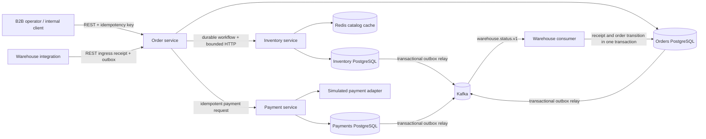

# Architecture and invariants

This repository is a newly built engineering reference implementation. It has real database transactions, durable recovery state, an actual Kafka transport, independent services, and repeatable tests. Production operation still requires running infrastructure, load/failure evidence, a real payment-provider integration, and operational ownership. A code generator cannot create a historical deployment, real users, or a team-leadership record.

## Why the services are separate

Each process has its own deployment unit, port, PostgreSQL database, database role, and migrations. The order workflow never joins tables across service databases. An inventory outage may delay order processing; the pending phase remains durable and resumes after recovery. Kafka warehouse updates are asynchronous: HTTP acceptance means the event was saved to the transactional outbox, not that the order already changed.

## Inventory and money

Inventory operations lock SKU rows in sorted order and serialize commands for the same order. Multi-SKU reservation is atomic. PostgreSQL CHECK constraints keep reserved/on-hand counts in their allowed range. Reserve, commit and release are idempotent state transitions, not repeated increments/decrements. A committed reservation cannot later be released.

Prices and order totals use integer minor units, checked for 64-bit overflow and domain maximum bounds; this implementation supports USD. Checkout calls the authoritative quote endpoint. Redis only caches display catalog data; it is never the source of truth for stock reservation or prices used to create an order. A Redis outage falls back to PostgreSQL. Catalog data can be stale for its bounded TTL, which is an explicit display-data tradeoff.

## Durable workflow and unknown outcomes

The persisted order steps are RESERVE → PAYMENT → COMMIT → DONE. Each step can be retried after process death. Dependency APIs bind the order ID to a request fingerprint and a durable result. If a process dies after a successful dependency call but before saving the next step, retrying repeats the same command rather than repeating the effect.

A payment decline moves to COMPENSATE, releases reserved stock, and cancels the order. A payment timeout has an unknown outcome and is retried at the same phase; it must not be treated as a decline. Repeated transient failures use persisted backoff and eventually park the workflow for explicit operator retry. No global transaction/automatic exactly-once guarantee is claimed.

The shipped payment adapter is deliberately simulated (`tok_approved` / `tok_declined`) and never contacts a payment network. A real integration must implement durable provider idempotency, authentication, reconciliation, refunds, webhook validation, and applicable payment-data handling requirements. Do not send card numbers to this API.

## Events

Outbox records are written in the same PostgreSQL transaction as their domain change. Relays mark records published only after broker acknowledgement. A relay crash between Kafka acknowledgement and PostgreSQL update may produce a duplicate; the design therefore provides at-least-once delivery and idempotent consumers.

Warehouse processing stores the consumer receipt and order transition in one transaction. Duplicate event IDs do not repeat effects, conflicting payloads are rejected, and stale sequence numbers or backwards state transitions cannot regress a shipment. Failures are persisted, retried a bounded number of times and then sent to `warehouse.status.v1.DLT`. The source offset is not committed when the DLT send fails. A replay preserves the original event identity and payload.

The local broker has one replica and is not broker-failure tolerant. Production topics need at least three brokers, replication factor 3, min.insync.replicas 2, broker ACLs and TLS/SASL. Partition key/order semantics and database durability remain part of the operational contract.

## Security boundary

The API key identifies one trusted internal/B2B operator/service identity. It is not a consumer identity system, tenant boundary, or OAuth implementation. Public consumer exposure requires a reviewed identity gateway and resource authorization model. Local Compose binds published ports to loopback; Kubernetes uses private ClusterIP services, restricted pods and explicit network policies. Credentials are generated or supplied out of band. TLS must terminate at a configured trusted ingress and data-service connections must verify server certificates.

## Scaling and backpressure

Workers use row locking and SKIP LOCKED to avoid simultaneous processing of one phase. Database pools, HTTP timeouts, body limits, bounded retry schedules, Kafka partitions and deployment resource limits provide explicit bounds. HPA configuration is included but is not proof of a capacity target. Measure database lock waits, pool saturation, outbox age and workflow backlog before increasing replicas.
